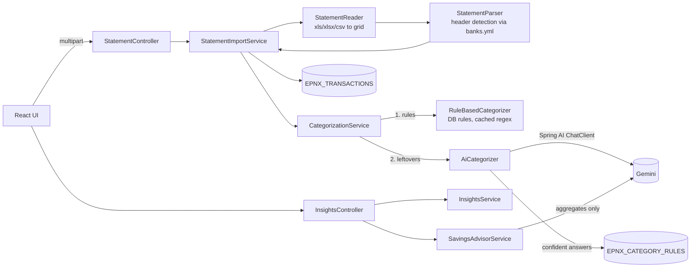

# Expense Calculator: Multi-bank, rule engine and Gemini AI

This document explains what changed in the expense calculator, why it changed, and how each piece works. It covers both repositories:

| Repo | Path | Stack |
|---|---|---|
| Backend | `intelliJWorkspace/expense-calculator` | Spring Boot **3.5.16**, Spring AI **1.1.8**, H2 file DB, Apache POI |
| Frontend | `VSCodeWorkspace/expense-calculator-ui` | React 18, Vite, Recharts, axios |

---

## 1. What you get

| Area | Before | Now |
|---|---|---|
| Banks | HDFC `.xls` only, with the parsing hard-coded to HDFC's layout | HDFC, ICICI, SBI, Axis and Kotak, in `.xls`, `.xlsx` or `.csv`. The bank is **auto-detected**. A new bank needs only a YAML block, no Java. |
| Categorisation | A 40-branch `if/else` in `TransactionUtils`, so every new merchant meant a code change | **Keyword rules stored in the DB**, seeded from YAML and editable from the UI. Unmatched transactions go to **Gemini through Spring AI**, and confident answers are saved as new rules. |
| Categories | Java `enum`, plus colours hard-coded in two UI files | DB table with name, icon, kind (expense/income/investment/transfer), an essential flag and a hint for Gemini. You can add categories from the UI. |
| Fixing mistakes | Not possible | Change the category per transaction. "Remember" creates a rule and applies it to past transactions. |
| Insights | Category totals per month | KPIs (spent, income, savings rate, invested, daily average, change vs last month), needs vs wants, category bars with drill-down, 12-month expenses vs income, top merchants, weekday pattern, biggest payments, recurring payments |
| Savings | None | **"Save more" page**: Gemini analyses your recent months and returns concrete tips with ₹ amounts. Without a key, rule-based tips are shown instead. |
| UPI notes | Ignored, apart from matching by luck when the word appeared somewhere in the narration | The note you type in GPay/PhonePe ("taxi", "meds") is extracted per bank, shown in the UI, and matched **first** by note-only rules. |
| People | One implicit user | **Profiles** (me, wife, mom…). Every statement belongs to a person. There are per-person and "Everyone" household views, and per-person rules. |

---

## 2. Running it

### Backend

```bash
cd intelliJWorkspace/expense-calculator
export GEMINI_API_KEY=your-key            # https://aistudio.google.com/apikey  (optional)
export GEMINI_MODEL=gemini-3.8-flash      # optional, this is the default
./mvnw spring-boot:run                    # http://localhost:8081/api/expense
```

* **The Gemini key is optional.** Without it the app starts normally. You get rules-only categorisation and heuristic savings tips, and the UI shows "Gemini off".
* `java.version` in the pom changed from 22 to **17**, because the only JDK on this machine is Corretto 17. The code builds and runs on 17 or anything newer, 22 included.
* Your existing `~/epnx_db` is upgraded automatically the first time it starts (see §9).

### Frontend

```bash
cd VSCodeWorkspace/expense-calculator-ui
npm run dev            # http://localhost:5173
```

The API URL defaults to `http://<host you opened the UI from>:8081/api/expense/v1`, so it also works from your phone on the LAN. You can override it with `VITE_API_BASE_URL` (see `.env.example`). The old hard-coded `192.168.68.111` is gone.

---

## 3. Architecture



### Package layout (backend)

```
com.expense.calculator
├── config/       ExpenseProperties (typed config), AiAvailabilityEnvironmentPostProcessor, StartupInitializer, WebConfig
├── domain/       EpnxTransaction, Profile, Category, CategoryRule + enums (CategoryKind, CategorySource, RuleSource, RuleScope, MatchType)
├── repository/   TransactionRepository (+Specifications), CategoryRepository, CategoryRuleRepository
├── bank/         StatementReader, StatementParser, BankProfileRegistry, Amounts, MerchantExtractor, RemarkExtractor, ParsedTransaction
├── category/     RuleBasedCategorizer, CategoryService (seed + CRUD), CategorizationService (pipeline)
├── ai/           GeminiClient, AiCategorizer, SavingsAdvisorService
├── service/      StatementImportService, TransactionService, InsightsService, ProfileService
├── dto/          request/response records
├── controller/   Statement, Transaction, Category, Insights controllers + ApiExceptionHandler
└── migration/    LegacyDataMigrator (upgrades the old HDFC-only DB)
```

Removed: `TransactionUtils` (the if/else chain), the `TransactionType` enum, `ExcelReadSaveService(Impl)`, `ExpenseCalculatorUtils`, `ObjectChecksumUtil`, the `hdfc.DTOs` package and the unused `import.sql`. Hibernate never executed `import.sql` with `ddl-auto=update`.

---

## 4. Profiles (multiple people)

* `EPNX_PROFILES` (`PROFILE_ID`, `NAME`, `EMOJI`). Every transaction has a `PROFILE_ID`. There is always at
  least one profile; the oldest is the **default** ("Me") used for legacy data and the old `/v1/hdfc/*` endpoints.
* **Uploads** take `profileId` ("Whose statement?" in the upload card, defaulting to the person selected in the
  top bar). Uniqueness is **(PROFILE_ID, BANK, REF_NUM)** - when you pay your wife, the same UPI reference
  appears in both statements and both are kept.
* **Reads** (`/transactions`, `/insights`, `/insights/savings`, `/transactions/recategorize`, `/rules`) take an
  optional `profileId`; omitted = everyone. The household view adds a **"Who spent what"** card
  (`MonthInsight.byProfile`) and a "Who" column in Transactions.
* **Rules** have an optional `PROFILE_ID`: `null` = shared (all seed rules), otherwise only that person's
  transactions. "Remember" on a transaction creates a rule for *that person* by default (a maid or a payee name
  is personal); rules Gemini learns are scoped to the person whose transactions taught them. Within the same
  priority, a person's own rules beat shared ones.
* Deleting a profile deletes its transactions and its own rules; the last profile cannot be deleted
  (the UI asks for confirmation inline).
* The selected person is remembered per browser (`localStorage`, wrapped in try/catch).
* **No login.** This is a local app: anyone who can open it sees every profile. Add Spring Security before
  exposing it beyond your home network.

## 5. UPI notes ("taxi", "meds")

When you pay with GPay/PhonePe/Paytm you can type a note; banks append it to the narration. In your HDFC data
it is the last segment: `UPI-<payee>-<vpa>-<ifsc>-<12-digit ref>-<note>` (TAXI 47×, MEDS 20×, FOOD 17×,
FAMILY 11×, GROCERY 6× in your history; HDFC truncates notes to 18 characters).

* **Extraction** - `RemarkExtractor` applies each bank's `remark-pattern` from `banks.yml` (a regex with a named
  group `remark`) and stores the note upper-cased in `EPNX_TRANSACTIONS.REMARK`. Boiler-plate notes added by apps
  (`UPI`, `PAYMENT FROM PHONE`, `UPIINTENT`, `PAY VIA RAZORPAY`, order ids …) are dropped via `remark-ignore`.
  HDFC's pattern is verified against your real statements; ICICI/SBI/Axis/Kotak patterns follow those banks'
  usual narration formats and are unverified.
* **Rules with `scope: REMARK`** match only the note, so a note rule `FOOD` never fires on a merchant called
  "NATURES FOOD STORE". **Note rules are evaluated before all narration rules** - if you pay a pharmacy but type
  "taxi", your note wins.
* Seeded note rules: TAXI/CAB/AUTO/RIDE → Cabs, MEDS/MEDICINE/DOCTOR/HOSPITAL/PHARMACY → Medical,
  FOOD/LUNCH/DINNER → Dining Out, GROCERY/VEGETABLES/MILK → Groceries, FAMILY → Parents & Family, RENT, MAID/COOK,
  PETROL/FUEL, SALON, MOVIE, GYM, GIFT, TRIP/HOTEL, SHOPPING, DRINKS/BEER, ELECTRICITY/RECHARGE.
  Add your own on the Rules page ("Match only my UPI note"), or tick **remember → for note "…"** on a transaction.
* Gemini receives the note as its own column and is told it is the strongest signal of purpose.
* On your data: after *Re-apply rules*, all 20 "MEDS" payments → Health & Medical, all 47 "TAXI" → Cabs.

## 6. Multi-bank support

### 6.1 Bank profiles: `src/main/resources/banks.yml`

Each bank is described as **data**:

```yaml
- code: ICICI
  display-name: ICICI Bank
  detect-keywords: [ "ICICI BANK", "ICIC0" ]          # text near the top of the file that identifies the bank
  date-formats: [ "dd/MM/yyyy", "dd-MM-yyyy", ... ]   # tried in order, ISO is always tried as well
  headers:                                           # role -> accepted header spellings
    date:       [ "Transaction Date", "Txn Date", "Date" ]
    narration:  [ "Transaction Remarks", "Remarks", ... ]
    withdrawal: [ "Withdrawal Amount", ... ]
    deposit:    [ "Deposit Amount", ... ]
    ...
```

Supported roles: `date`, `valueDate`, `narration`, `ref`, `withdrawal`, `deposit`, `balance`. Banks that export a single signed column use `amount` with `drCr` instead (Kotak style: `Amount` + `Dr / Cr`).

**To add a bank**, copy a block, change the header spellings to match the bank's export, and restart. No Java change is needed.

> ⚠️ The HDFC profile matches the layout the old code parsed and is tested against a synthetic HDFC file. The ICICI, SBI, Axis and Kotak header spellings come from their usual exports but **have not been checked against your real statements**. If an upload fails with "Could not find the transaction table header", compare the header row in the file with `banks.yml` and add the spelling.

### 6.2 Reading: `StatementReader`

* `.xls`/`.xlsx` go through POI's `WorkbookFactory`. `.csv` goes through a small RFC-4180 parser that handles quoted commas and quoted fields spanning lines.
* Date-formatted cells become ISO `yyyy-MM-dd`. Numbers in "General" format become plain decimals, so long reference numbers never turn into `4.12E+11`. Formula cells use their cached value; the old code stored the formula text.
* Column positions stay stable when leading cells are empty.

### 6.3 Parsing: `StatementParser`

1. **Find the header row.** This is the first of the top 80 rows that has *date + narration + (withdrawal & deposit, or amount)* columns. Headers are normalised (lower-case, a-z0-9 only), so `"Withdrawal Amt."` matches `withdrawalamt`. An alias of 5+ characters also matches as a prefix, so `"Withdrawal Amount (INR )"` matches `withdrawalamount`. Each column is assigned to at most one role.
2. **Read the rows** below it:
   * The row's date must parse with one of the profile's formats. Otherwise, if the row only has narration text, it is appended to the previous transaction. SBI and ICICI wrap long narrations onto a second row.
   * HDFC's `*******` separator rows are skipped. The second one, after data has started, ends the table, the same as the old logic.
   * Rows with no amount, such as opening balance lines, are dropped.
3. **Parse amounts** with `Amounts.parse`, which accepts `1,23,456.78`, `₹ 500`, `500.00 Dr` and `(250.00)`. Blanks and zero become `null`, as before.

**Auto-detection** (`bank=AUTO`, the default) scores every profile: number of header roles matched, plus 10 if one of its `detect-keywords` appears near the top of the file. The highest score wins. You can always choose the bank explicitly in the UI.

### 6.4 De-duplication

Uniqueness is now **(BANK, REF_NUM)** instead of `REF_NUM` alone. A transfer between two of your own accounts legitimately shows the same UPI reference in both banks' statements.

* Re-uploading a statement **updates** existing rows instead of inserting duplicates.
* Lines with no usable reference (blank or all zeros) get a deterministic id: `H-` plus the SHA-256 of bank, date, narration, amounts and balance. The old code tried to Java-serialise the entity, which isn't `Serializable`, so the checksum silently failed and those rows kept `000000000000000`.
* The same reference appearing twice in one file (a reversal, for example) gets `#2`, `#3` and so on.
* On re-upload, categories set **manually** or by **Gemini** are kept. Rule-based categories are re-evaluated, so new rules take effect.

---

## 7. Categorisation: from if/else to a data-driven pipeline

### 7.1 Data model

`EPNX_CATEGORIES`:

| column | meaning |
|---|---|
| `CODE` | Stable id stored on transactions, e.g. `SWIGGY`. Existing codes were kept so old data stays valid. |
| `DISPLAY_NAME`, `ICON` | Shown in the UI. Previously these were two hard-coded colour maps in the frontend. |
| `KIND` | `EXPENSE` / `INCOME` / `INVESTMENT` / `TRANSFER`, which controls how insights count the money (§10) |
| `ESSENTIAL` | Needs vs wants, used by the needs/wants meter and the savings advisor |
| `DESCRIPTION` | Hint sent to Gemini, e.g. *"Food delivery and 10-minute grocery apps: Swiggy, Instamart, Zomato, Blinkit, Zepto"* |

`EPNX_CATEGORY_RULES`: `KEYWORD`, `MATCH_TYPE` (`WORD` | `REGEX`), `CATEGORY_CODE`, `PRIORITY`, `SOURCE` (`SEED` | `USER` | `AI`).

`EPNX_TRANSACTIONS` gained `BANK`, `MERCHANT`, `CATEGORY_SOURCE` (`RULE` | `AI` | `MANUAL` | `NONE`) and `CLOSING_BALANCE`.

### 7.2 Seeding: `category-seed.yml`

* **Every branch of the old `TransactionUtils` was ported one-to-one** as a rule. For example, `EDUNETWORK → RENT`, `GEDDIT → SWIGGY` and `COUNTRY DELIGHT → PARENTS` (from your last commit).
* New generic categories were added so Gemini has sensible buckets: Groceries, Fuel, Medical, Bills & Utilities, Insurance, EMI & Loans, Education, Entertainment, Fitness, Personal Care, Gifts, Cash Withdrawal, Credit Card Bill, Self Transfer, Refunds. Common Indian merchants for these are seeded too (BigBasket, DMart, IRCTC, BookMyShow, CRED, Groww, ATM withdrawals and so on).
* On start-up, seed categories missing from the DB are added. Rules are seeded **only into an empty rule table**, so rules you delete stay deleted.
* `OASIS_BREEZE` is described as "apartment / society" and marked essential. That is a guess, so edit it on the Rules page if it's wrong.

### 7.3 `RuleBasedCategorizer`

* Rules load from the DB once, compile to `Pattern`s and are cached. The cache refreshes whenever a rule changes.
* `WORD` match: case-insensitive whole word, not preceded or followed by a letter or digit. The keyword is `Pattern.quote`d, so `UPI-NA-NA` and `C/O` are safe.
* **Ordering:**
  1. UPI-note rules (`scope: REMARK`) come first.
  2. Then higher priority (USER 10 > AI 5 > SEED 0).
  3. Then a person's own rules before shared ones.
  4. Then the longer keyword first.

  This fixes a real bug in the old chain: `SWIGGY` was checked before `SWIGGY DINEOUT`, so `DINNER` could never match. Now `SWIGGY DINEOUT` wins because it is longer. Your own rules always beat the seeded ones, and rules belonging to another profile are skipped.

### 7.4 `CategorizationService`: the pipeline

```
for each transaction:
   MANUAL?                 -> leave it alone
   a rule matches?         -> category = rule, source = RULE
   else                    -> queue for Gemini
Gemini (batched)           -> category = answer, source = AI, merchant = cleaned name
still unknown / AI off     -> OTHERS, source = NONE
```

**Learning.** When Gemini answers with confidence ≥ `expense.ai.min-confidence-to-learn` (0.8), the merchant is ≥ 4 characters, not a generic word (UPI, PAYMENT, LIMITED…), and **appears as a whole word in the narration**, a rule `merchant → category` with `source=AI` is created. The next statement containing that merchant is categorised by the rule engine at no API cost. AI rules are visible, with an AI badge, on the Rules page, where you can delete them.

### 7.5 Merchant extraction: `MerchantExtractor`

This is a deterministic best-effort payee name, used for "top merchants", recurring detection and as the default keyword when you tick "remember":

```
UPI-SWIGGY LIMITED-swiggy.upi@icici-ICIC0DC0099-4123...-PAYMENT  ->  SWIGGY LIMITED
POS 512345XXXXXX1234 AMAZON PAY INDIA                             ->  AMAZON PAY INDIA
UPI/DR/400512345678/BIGBASKET/YESB/bigbasket@ybl                  ->  BIGBASKET
```

It splits on `- / : | *`, drops leading noise (UPI, NEFT, POS…), VPAs, IFSC codes and masked or numeric tokens, and trims trailing noise. Gemini's merchant name replaces it for AI-categorised rows.

---

## 8. Gemini via Spring AI

### 8.1 Dependency and configuration

```xml
<dependency>  <!-- version from spring-ai-bom 1.1.8 -->
  <groupId>org.springframework.ai</groupId>
  <artifactId>spring-ai-starter-model-google-genai</artifactId>
</dependency>
```

The **Google GenAI** starter talks to the Gemini Developer API with a plain API key. You don't need a GCP project or Vertex AI.

Spring Boot was bumped from 3.3.2 to **3.5.16** because Spring AI 1.x requires Boot 3.4+. Spring AI 2.x requires Boot 4, which would have been a much bigger migration.

`application.properties`:

```properties
spring.ai.google.genai.api-key=${GEMINI_API_KEY:}
spring.ai.google.genai.chat.options.model=${GEMINI_MODEL:gemini-3.8-flash}
spring.ai.google.genai.chat.options.thinking-level=${GEMINI_THINKING_LEVEL:LOW}
expense.ai.enabled=${EXPENSE_AI_ENABLED:true}
expense.ai.batch-size=25
expense.ai.learn-rules=true
expense.ai.min-confidence-to-learn=0.8
```

### 8.2 Running without a key: `AiAvailabilityEnvironmentPostProcessor`

Spring AI's Google GenAI auto-configuration **throws at start-up** when no key is set ("Incomplete Google GenAI configuration"). This post-processor is registered in `META-INF/spring.factories`. When `spring.ai.google.genai.api-key` is blank it sets `spring.ai.model.chat=none`, along with the embedding equivalents. As a result there is no `ChatModel` bean. `GeminiClient` takes an `ObjectProvider<ChatModel>`, reports `isEnabled() == false`, and every AI feature degrades gracefully. An explicit `spring.ai.model.chat` setting always wins.

### 8.3 Transaction classification: `AiCategorizer`

* It uses `ChatClient` with a **system prompt** containing the classification rules: pick exactly one allowed code, credits are usually salary/interest/refund, a payment to a person with no hint is OTHERS, return a merchant name and confidence.
* The **user prompt** carries the allowed categories (code, kind, name, description) and the batch as `id | DEBIT/CREDIT | amount | narration`.
* **Structured output:** `.call().entity(Reply.class)` binds `{"results":[{"id","category","merchant","confidence"}]}`. Spring AI's `BeanOutputConverter` adds the JSON-schema instructions and strips ```` ```json ```` fences.
* **Cost control:** identical narrations are sent once. Requests go out in batches of 25. Unknown codes in the reply are ignored. Any exception becomes `AiUnavailableException`, which is reported in the upload result (`aiError`). **An upload never fails because Gemini is down.**

### 8.4 "Where can I save more?": `SavingsAdvisorService`

1. Builds a **profile from aggregates only**:
   * monthly totals per category with kind and essential flag
   * average income, expenses, invested, essential and discretionary amounts
   * savings rate per month
   * top merchants
   * detected recurring payments

   **No raw narrations, account numbers or reference numbers are sent.**
2. The system prompt asks for 4–7 tips that are concrete and quantified. Discretionary spending, spikes, frequent small orders and subscriptions get priority. It must never suggest cutting family support, rent or investing. Tips come back as `{title, category, detail, currentMonthlySpend, suggestedMonthlyBudget, potentialMonthlySaving, difficulty}` plus a summary and quick wins.
3. Results are **cached** per data fingerprint and period, so reopening the page costs nothing. "Regenerate" forces a new call.
4. **Fallback** (no key or an error): local heuristics.
   * Cap the four largest discretionary categories at 20% below the current level. OTHERS is excluded because "cut Others" isn't actionable.
   * Flag discretionary categories where the latest month is more than 30% above the earlier average.

   The response has `source: "HEURISTIC"` and a notice explaining why.

### 8.5 Privacy note

Transaction categorisation **does** send the narrations of *unmatched* transactions to Google. These include payee names and UPI handles. Matched transactions never leave your machine. If this matters to you, leave `GEMINI_API_KEY` unset or set `EXPENSE_AI_ENABLED=false`, and add rules manually.

---

## 9. Upgrading your existing database: `LegacyDataMigrator`

This runs on every start, is idempotent, and runs before seeding:

1. Drops the old single-column unique constraint on `REF_NUM` if one exists. It queries `INFORMATION_SCHEMA`, so the constraint name isn't hard-coded. Your DB turned out not to have one.
2. **Disambiguates legacy duplicate references.** Your DB has 3 pairs of *different* transactions sharing a ref number, probably reversals. The later row of each pair gets `#2`, which is the same convention the importer uses, so re-uploading those statements still matches.
3. Back-fills `BANK='HDFC'`, `MERCHANT` (via `MerchantExtractor`) and `CATEGORY_SOURCE`: `RULE` for categorised rows, `NONE` for `OTHERS`.
4. Creates the default profile "Me" and assigns every existing transaction to it.
5. Extracts UPI notes for old rows.
6. Drops any unique constraint on the transactions table that does not include `PROFILE_ID`.

**Startup ordering:** the migration and seeding run in `StartupInitializer`, a `SmartInitializingSingleton`, so they finish *before* Tomcat accepts requests. An `ApplicationRunner` runs after the server is already up. In testing, a request that arrived mid-migration created a duplicate default profile; this ordering fixes that.

**Verified on a copy of your real `~/epnx_db`** (H2 2.2 file opened by H2 2.3):
* all 2,659 rows were migrated to the "Me" profile
* the 3 duplicate pairs were disambiguated
* 24 months show on the dashboard
* the second start makes no changes

The original file was not touched during testing. Hibernate's `ddl-auto=update` adds the new columns and tables.

**After the first start**, open *Transactions → Re-apply rules*. On your data the seed and note rules match 1,431 of 2,659 transactions. Then, with a key set, press *Categorise unknown with Gemini* for the remaining ~1,228.

---

## 10. Insights: `InsightsService`

This is computed in Java over the stored transactions. A personal data set is small, and this replaces the H2-specific native `FORMATDATETIME` query. Definitions:

| metric | definition |
|---|---|
| `totalSpent` | All withdrawals. This is the same number the old dashboard showed. |
| `invested` | Withdrawals in `INVESTMENT` categories (counted as saved) |
| `transfers` | Withdrawals in `TRANSFER` categories: card bills and self transfers |
| `expenses` | `totalSpent − invested − transfers` |
| `income` | Deposits, excluding `TRANSFER` categories |
| `savingsRate` | `(income − expenses) / income` |
| `essential` / `discretionary` | Expenses split by the category's `essential` flag |
| `avgDailySpend` | Expenses ÷ days. For the current month, only the days elapsed so far. |
| `changePct` | Against the previous month that has data |
| recurring | A merchant paid in ≥ 3 distinct months whose monthly totals vary < 25% (coefficient of variation) |

`GET /v1/insights` returns all months, newest first, with categories, top merchants, the 5 biggest payments, daily and weekday spend, plus overall averages and recurring payments. The UI navigates months on the client.

---

## 11. REST API (`/api/expense/v1`)

| Method | Path | Purpose |
|---|---|---|
| GET/POST | `/profiles` | List (with transaction counts), or create `{name, emoji}` |
| PUT/DELETE | `/profiles/{id}` | Rename, or delete along with its transactions and own rules |
| GET | `/banks` | Supported banks from `banks.yml` |
| POST | `/statements/upload` | `file` + `bank` (`AUTO` by default) + `profileId` (the default profile if omitted). Returns counts: inserted, updated, by rules, by AI, uncategorised, `aiError`. |
| GET | `/transactions` | Filters: `profileId`, `year`, `month`, `category`, `bank`, `q` (merchant, note or narration), `uncategorized`, `page`, `size` |
| PATCH | `/transactions/{id}/category` | `{category, createRule, ruleKeyword?, ruleScope? (NARRATION/REMARK), ruleForAllProfiles?}`: manual override, with an optional rule applied to history |
| POST | `/transactions/recategorize?ai=true&profileId=` | Re-apply rules to non-manual rows, then send the rest to Gemini |
| GET/POST | `/categories` | List, or create/update (code is the key) |
| GET/POST/DELETE | `/rules`, `/rules/{id}` | Manage keyword rules. POST takes `scope` (NARRATION/REMARK), `profileId` (omit for everyone) and `applyToExisting`. |
| GET | `/insights?profileId=&bank=` | Dashboard data. Omitting `profileId` gives the household view with a `byProfile` breakdown. |
| GET | `/insights/savings?profileId=&months=3&refresh=false` | Gemini savings plan (heuristic fallback) |
| GET | `/ai/status` | `{enabled, model, hint}` |
| POST | `/hdfc/transactionupload` | **Kept for compatibility.** Same as upload with `bank=HDFC`. |
| GET | `/hdfc/graphdata` | **Kept for compatibility.** Same JSON shape as before. |

Errors come back as `{"error": "..."}` with 400, 404 or 413.

---

## 12. Frontend

```
src/
├── api.js                  axios client, env-configurable base URL, ₹ formatters
├── profile.jsx             ProfileProvider (selected person, remembered per browser) + top-bar ProfileSwitcher
├── App.jsx                 top bar (nav, person switcher, "Gemini on/off" pill) and routes
├── index.css               design tokens with light and dark themes (follows the OS setting)
├── components/
│   ├── UploadCard.jsx      whose statement + bank selector (auto-detect default) + drag-and-drop for xls/xlsx/csv, import summary
│   ├── charts.jsx          CategoryBars, TrendChart, WeekdayChart, SplitMeter, ChartTooltip, useChartColors
│   └── NotFound.jsx
└── pages/
    ├── Dashboard.jsx       month navigator, KPIs, needs vs wants, charts, category tiles, merchants, recurring
    ├── Transactions.jsx    filterable table, inline category change + "remember", re-apply rules, Gemini button
    ├── SaveMore.jsx        period picker, AI savings plan: total, summary, tip cards with budget/saving bars
    ├── Rules.jsx           add rule (narration or UPI-note scope, everyone or one person) / category, rules table
    └── Profiles.jsx        add / rename / delete people (inline delete confirmation)
```

Chart design choices:
* **Category spend is a horizontal bar chart in one colour**, replacing the pie with up to 18 colours. With that many categories, a pie can't be read and the colours become indistinguishable.
* Expenses vs income share one axis. Legends and tooltips appear on every multi-series chart. Only the peak weekday gets a value label.
* The palette was checked with a colour-blindness validator for light and dark mode. The two lower-contrast colours (aqua and yellow, in the needs/wants meter) always carry visible text labels.
* Clicking a category bar or tile, or the "uncategorised" banner, deep-links into Transactions with filters applied. Clicking a month in the trend chart jumps to that month.

The removed `PieChartComponent`, `SimpleBarChart`, `MonthlyStats`, `UploadPage`, `Home` and `About` are replaced by the pages above. `/bar-chart` redirects to the dashboard.

---

## 13. Tests (`./mvnw test`, 20 tests)

| Test | Covers |
|---|---|
| `StatementParserTest` | HDFC `.xls` (header block, star separators, summary ignored) with auto-detect; SBI CSV with Indian number format, `d MMM yyyy` dates and a wrapped narration; Kotak `Amount + Dr/Cr`; helpful error for the wrong bank; amount parsing |
| `RuleBasedCategorizerTest` | Longer keyword wins (the DINEOUT bug), whole word (`RENT` does not match `PARENTS`), USER beats SEED, regex rules, **a note beats the merchant**, note rules ignore merchant text, per-profile rules |
| `MerchantExtractorTest` | UPI, POS, SBI and NEFT narration shapes |
| `ExpenseCalculatorApplicationTests` | Full stack **without a key**: upload, rule categorisation, re-upload dedupe (including all-zero refs), insights numbers, legacy `graphdata`, heuristic savings, manual override + rule, bad file → 400 |
| `RemarkExtractorTest` | HDFC/SBI note extraction; boiler-plate and order ids ignored |
| `ProfilesTests` | two people uploading the same statement (no ref clash), note rules (TAXI/MEDS), "remember" scoped to one person, per-person vs household insights, profile delete cascade, last profile protected |
| `AiCategorizationTests` | Full Spring AI path with a **stub `ChatModel`** standing in for Gemini: prompt content, ```` ```json ```` fenced structured output, AI category stored, **rule learned**, savings plan bound from JSON |

Tests use an in-memory H2 (`application-test.properties`), so they never touch `~/epnx_db`.

**Not verified here:** a live call to Gemini, because no API key was available. The stub test covers everything up to the HTTP call. The first time you set `GEMINI_API_KEY`, try *Save more → Analyse* and *Categorise unknown with Gemini*.

---

## 14. Extending

* **New bank:** add a block to `banks.yml`.
* **New person:** Profiles page.
* **New merchant or UPI-note mapping:** Rules page, or tick "remember" when fixing a transaction.
* **New category:** Rules page → *Add a category*. Write a good Gemini hint in the description.
* **Different model:** set `GEMINI_MODEL`, e.g. `gemini-3.5-flash-lite` (cheaper). `gemini-2.5-*` models are closed to new API keys.
* **Another LLM provider:** swap the Spring AI starter, e.g. `spring-ai-starter-model-openai`, and update `AiAvailabilityEnvironmentPostProcessor.API_KEY`. `AiCategorizer` and `SavingsAdvisorService` depend only on `ChatClient`.
