# Expense Calculator

Upload your bank statements and see where your money goes. The app categorises every transaction automatically, using keyword rules, the notes you type in your UPI app, and Google Gemini for anything it doesn't recognise. Gemini can also tell you where to save. One app covers the whole family: you, your wife, your mom.

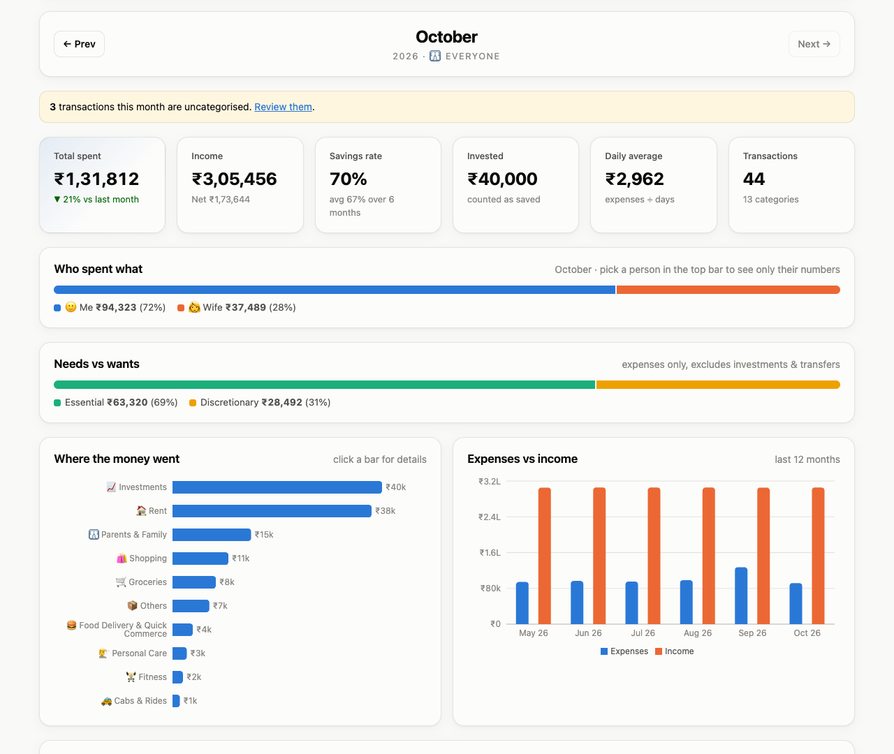

> All screenshots use the **fictional demo statements** in [`docs/demo-statements/`](docs/demo-statements), so you can recreate them yourself.

---

## Contents

1. [Features](#features)
2. [How it fits together](#how-it-fits-together)
3. [Prerequisites](#prerequisites)
4. [Set up the API (backend)](#1-set-up-the-api-backend)
5. [Set up the UI (frontend)](#2-set-up-the-ui-frontend)
6. [Get a Gemini API key (optional)](#3-get-a-gemini-api-key-optional)
7. [How to use it](#how-to-use-it), a step-by-step walkthrough with screenshots
8. [Supported banks](#supported-banks)
9. [Configuration reference](#configuration-reference)
10. [Troubleshooting](#troubleshooting)
11. [Data & privacy](#data--privacy)
12. [Development](#development)

---

## Features

| | |
|---|---|
| 🏦 **Multiple banks** | HDFC, ICICI, SBI, Axis and Kotak statements as `.xls`, `.xlsx` or `.csv`. The bank is detected automatically. Re-uploading the same statement updates rows instead of duplicating them. |
| 🏷️ **Automatic categories** | More than 110 built-in keyword rules (Swiggy, Zomato, Uber, Amazon, Zerodha, rent…). You can add your own from the UI. |
| 📝 **UPI notes** | Type "taxi" or "meds" in GPay or PhonePe when you pay and the transaction is filed under Cabs or Medical. Your note beats the merchant name. |
| ✨ **Gemini AI** | Transactions no rule recognises are classified by Gemini through Spring AI. Confident answers become rules, so the same merchant never costs another API call. |
| 💡 **Save more** | Gemini reviews your recent months and suggests specific cuts with ₹ amounts. Without a key you get rule-based tips. |
| 👪 **Profiles** | One profile per person, with a household "Everyone" view and a "who spent what" breakdown. |
| 📊 **Insights** | Savings rate, needs vs wants, month-over-month change, top merchants, recurring payments, weekday pattern and biggest payments. |
| 🌗 **Light & dark, phone-friendly** | Follows your OS theme and works on a phone over your home Wi-Fi. |

---

## How it fits together

The app is two repositories that run side by side on your machine:

| Repo | What | Default address |
|---|---|---|
| [`expense-calculator`](https://github.com/ashwaniagarwal226/expense-calculator) (this repo) | **API**: Spring Boot 3.5, Spring AI (Gemini), H2 database stored in a file | `http://localhost:8081/api/expense` |
| [`expense-calculator-ui`](https://github.com/ashwaniagarwal226/expense-calculator-ui) | **UI**: React 18, Vite, Recharts | `http://localhost:5173` |

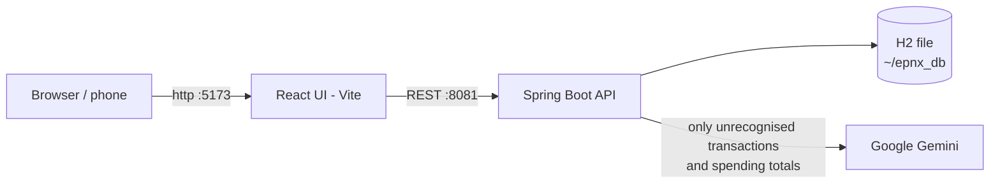

Your data stays in a single file, `~/epnx_db.mv.db`, in your home folder. The only thing that ever leaves your machine is what goes to Gemini (see [Data & privacy](#data--privacy)), and only when you set an API key.

---

## Prerequisites

| Tool | Version | Check with |
|---|---|---|
| **Java JDK** | 17 or newer (17, 21, 22 all work) | `java -version` |
| **Node.js** | 18 or newer (with npm) | `node -v` |
| **Git** | any | `git --version` |
| Maven | *not needed*: the repo ships the Maven wrapper `./mvnw` | |
| Gemini API key | *optional*, free tier is enough | see [step 3](#3-get-a-gemini-api-key-optional) |

> **macOS tip:** `brew install openjdk@17 node` installs both. On Windows, use the Temurin JDK installer and the Node.js LTS installer, and run `mvnw.cmd` instead of `./mvnw`.

---

## 1. Set up the API (backend)

```bash
git clone https://github.com/ashwaniagarwal226/expense-calculator.git
cd expense-calculator

# optional: enables AI categorisation and savings advice (see step 3)
export GEMINI_API_KEY=your-key-here

./mvnw spring-boot:run
```

The first run downloads dependencies, which takes a minute. Wait for:

```
Started ExpenseCalculatorApplication in 3.4 seconds
```

**Check it's running:**

```bash
curl http://localhost:8081/api/expense/v1/ai/status
# {"enabled":true,"provider":"gemini","model":"gemini-2.5-flash","hint":null}
```

`"enabled": false` means it's running without Gemini. That's fine, and you can add the key later.

**Running from IntelliJ IDEA:** open the folder as a Maven project and set *Project SDK* to 17 or newer. Run `ExpenseCalculatorApplication`. To use Gemini, add `GEMINI_API_KEY=…` under *Run → Edit Configurations → Environment variables*.

**Building a standalone jar:**

```bash
./mvnw clean package
java -jar target/expense-calculator-0.0.1-SNAPSHOT.jar
```

> **Upgrading from the old HDFC-only version?** Nothing to do. On first start the app upgrades your existing `~/epnx_db` in place. All transactions are kept and assigned to a profile called **"Me"**, which you can rename. Afterwards, open **Transactions → Re-apply rules** once so the new rules and UPI notes apply to your history. Back up `~/epnx_db.mv.db` first if you want to be extra safe.

---

## 2. Set up the UI (frontend)

In a second terminal:

```bash
git clone https://github.com/ashwaniagarwal226/expense-calculator-ui.git
cd expense-calculator-ui
npm install
npm run dev
```

Open **http://localhost:5173**. The pill in the top-right corner shows **Gemini on/off**, which confirms the UI can reach the API.

**On your phone:** `npm run dev` also listens on your network. Vite prints a `Network: http://192.168.x.x:5173` address; open it on a phone on the same Wi-Fi. The UI calls the API on the same host at port 8081, so no configuration is needed. If the phone can't connect, see [troubleshooting](#troubleshooting).

**The API somewhere else?** Copy `.env.example` to `.env.local` and set:

```bash
VITE_API_BASE_URL=http://my-server:8081/api/expense/v1
```

**Production build** (static files you can host anywhere):

```bash
npm run build      # outputs to dist/
npm run preview    # serves dist/ locally to try it
```

---

## 3. Get a Gemini API key (optional)

1. Go to **https://aistudio.google.com/apikey** and sign in with a Google account.
2. Click **Create API key** and copy it.
3. Make it available to the backend, then restart the backend:

   ```bash
   # macOS / Linux, current terminal only
   export GEMINI_API_KEY=AIza...

   # make it permanent (zsh)
   echo 'export GEMINI_API_KEY=AIza...' >> ~/.zshrc

   # Windows PowerShell
   setx GEMINI_API_KEY "AIza..."
   ```

The default model is `gemini-2.5-flash`, which is fast and cheap. To change it, set `GEMINI_MODEL`, e.g. `gemini-2.5-flash-lite` or `gemini-2.5-pro`.

Without a key, everything except the ✨ features still works.

---

## How it works, step by step

### Step 1: Create a profile for each person

Go to **Profiles** and add everyone whose statements you want to track. A profile called **"Me"** already exists. Rename it if you like.

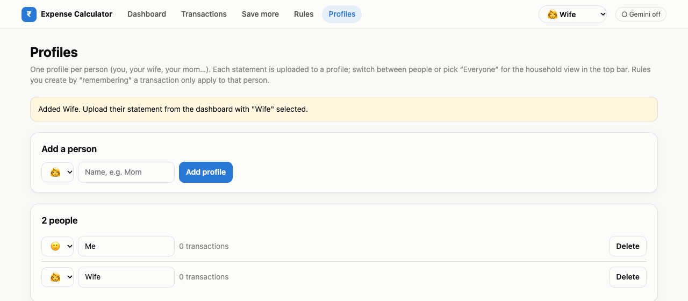

The **person switcher** in the top bar picks whose data you're looking at. **👪 Everyone** combines the whole household. Your choice is remembered in the browser.

### Step 2: Download a statement from your bank

| Bank | Where to find it | Format |
|---|---|---|
| HDFC | NetBanking → *Accounts → Account Statement* → choose period → **Download as XLS** | `.xls` |
| ICICI | Internet Banking → *My Accounts → Bank Accounts → Account Statement* → **XLS** | `.xls` |
| SBI | OnlineSBI → *Account Statement* → **Excel** | `.xls` / `.xlsx` |
| Axis | Internet Banking → *Accounts → Statement* → **Excel / CSV** | `.xlsx` / `.csv` |
| Kotak | Net Banking → *Statements* → **Excel / CSV** | `.xlsx` / `.csv` |

Menu names change from time to time. Any period works; monthly or the full year are both fine.

> Want to try the app first? Use the fictional files in [`docs/demo-statements/`](docs/demo-statements).

### Step 3: Upload it

On the **Dashboard**:
1. Choose **Whose** statement it is (it defaults to the person selected in the top bar).
2. Leave **Bank** on *Detect automatically*.
3. Drop the file onto the box.

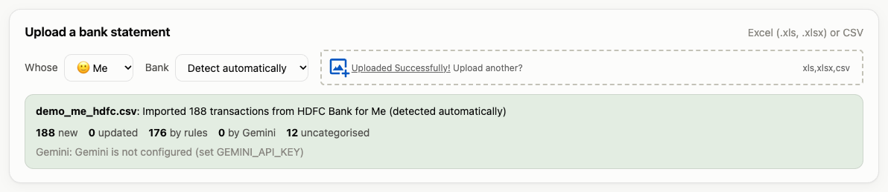

The summary shows how many transactions were new or updated, and how each was categorised: by rules, by Gemini, or not at all. Uploading the same or an overlapping statement again is safe, because existing transactions are updated rather than duplicated.

### Step 4: Read your dashboard

Use **← Prev / Next →** to move between months.


* **KPI tiles:** total spent (with change vs last month), income, **savings rate** (investments count as saved), amount invested, daily average and number of transactions.
* **Who spent what** (Everyone view): each person's share of the month.
* **Needs vs wants:** essential spend (rent, groceries, medical…) vs discretionary spend (food delivery, shopping…).
* **Where the money went:** click a bar to see its details and jump to those transactions.
* **Expenses vs income:** the last 12 months. Click a month to open it.

Further down:

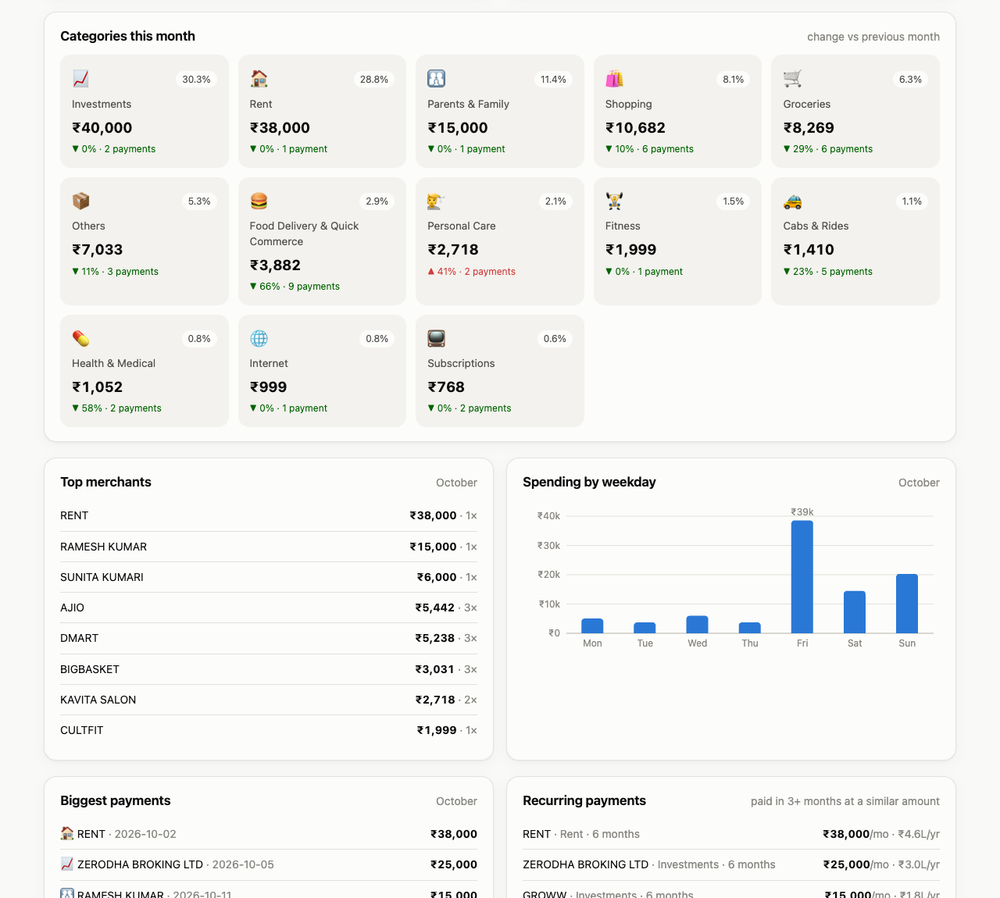

* **Category tiles:** share of spend, change vs last month (▼ green means you spent less), and number of payments. Click a tile to see its transactions.
* **Top merchants**, **spending by weekday**, **biggest payments**, and **recurring payments**: anything paid in 3 or more months at a similar amount, such as rent, SIPs or subscriptions, with a yearly estimate.

### Step 5: Use UPI notes so payments categorise themselves

When you pay with GPay, PhonePe or Paytm, type a short note. The bank prints it at the end of the narration, and the app picks it up:

| Type this note | Lands in |
|---|---|
| `taxi`, `cab`, `auto`, `ride` | 🚕 Cabs & Rides |
| `meds`, `medicine`, `doctor`, `hospital`, `pharmacy` | 💊 Health & Medical |
| `food`, `lunch`, `dinner`, `breakfast` | 🍽️ Dining Out |
| `grocery`, `vegetables`, `fruits`, `milk` | 🛒 Groceries |
| `family` | 👨‍👩‍👧 Parents & Family |
| `rent`, `maid`, `cook`, `petrol`, `salon`, `movie`, `gym`, `gift`, `trip`, `hotel`, `shopping`, `drinks`, `electricity`, `recharge` | the matching category |

Notes show up as a tag next to the merchant:

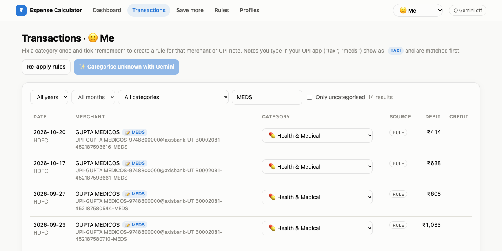

A note always wins over the merchant name. Paying a pharmacy with the note "taxi" files the payment under Cabs. You can teach the app new note words on the Rules page (see step 7).

> UPI notes are confirmed working for **HDFC** statements. The patterns for the other banks follow their usual narration format but haven't been checked against real statements.

### Step 6: Fix what's uncategorised, once

The dashboard tells you how many transactions are uncategorised. Click **Review them**, or open **Transactions** and tick *Only uncategorised*.

Pick the right category. Tick **remember** to create a rule for that merchant, or for that UPI note when the transaction has one. Then click **Save**:

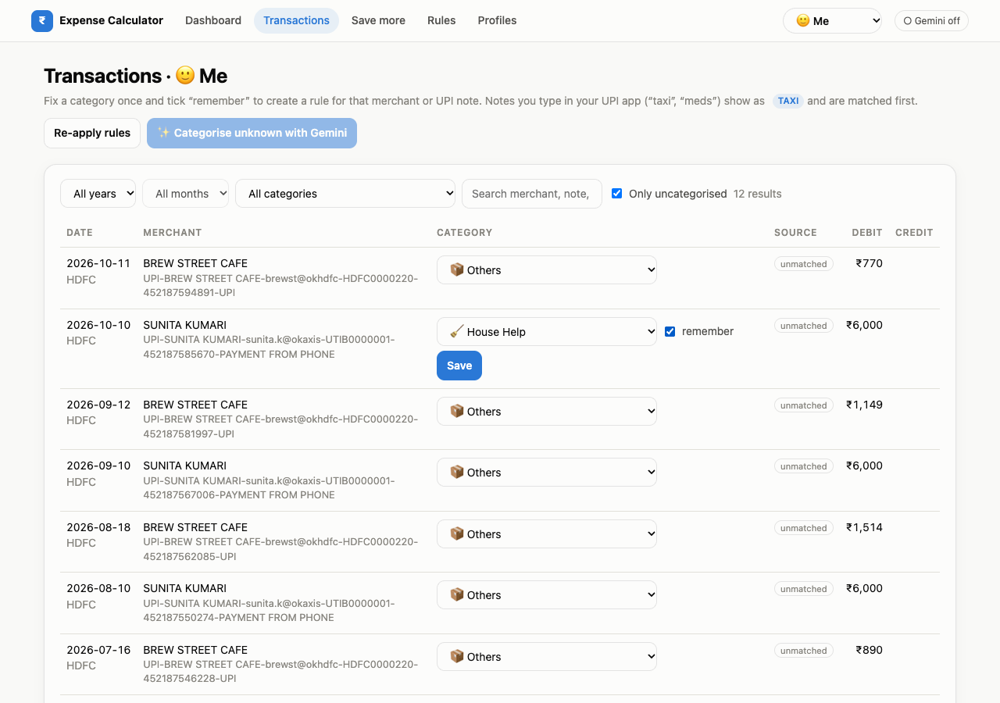

The rule is applied straight away to that person's other matching transactions:

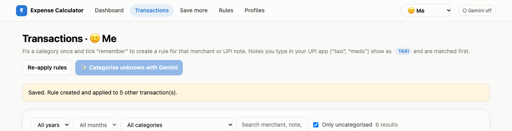

Two buttons at the top:
* **Re-apply rules** runs all rules over existing transactions again. Use it after adding or deleting rules. Categories you set by hand are never changed.
* **✨ Categorise unknown with Gemini** sends the remaining uncategorised transactions to Gemini. This needs an API key.

The **Source** badge on each row shows how it was categorised: `RULE`, `AI` (Gemini), `MANUAL` (you), or `unmatched`.

### Step 7: Manage rules and categories

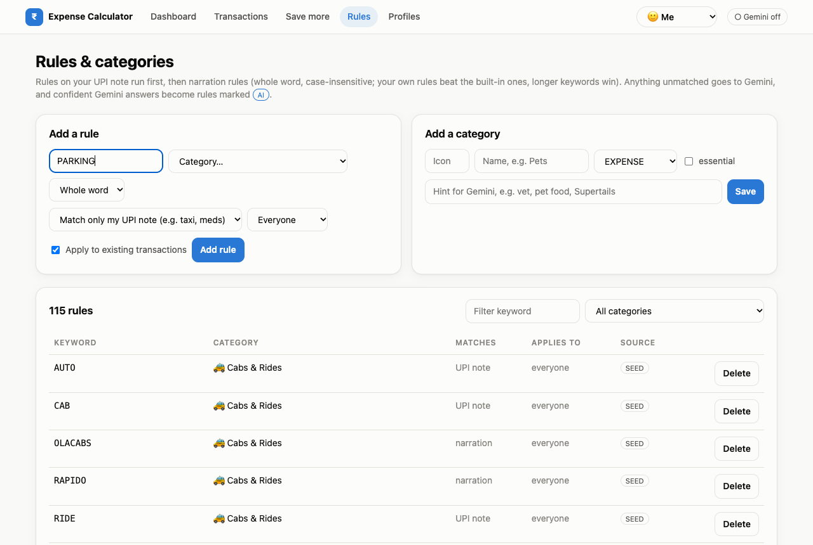

* **Add a rule:** a keyword, a category, and what it should match:
  * *Match anywhere in the narration*: merchant names such as `DECATHLON`.
  * *Match only my UPI note*: words you type when paying, such as `parking`.
* **Applies to:** *Everyone*, or one person. Your maid's name only means "House Help" for you.
* **Add a category:** name, icon, type (expense, income, investment or transfer), and whether it's *essential*. The *hint* helps Gemini understand what belongs in it.
* The rules table shows each rule's **source**: `SEED` (built-in), `USER` (yours), or `AI` (learned from Gemini). Delete any you don't want.

How a rule wins:
1. UPI-note rules are checked first.
2. Then your own rules, then rules learned from Gemini, then built-in rules.
3. Then a person's own rules before shared ones.
4. Then longer keywords first, so `SWIGGY DINEOUT` beats `SWIGGY`.

### Step 8: Find where to save ✨

Open **Save more**, choose a period (1, 3, 6 or 12 months) and click **Analyse**. Pick a person in the top bar first, or use *Everyone* for household advice.

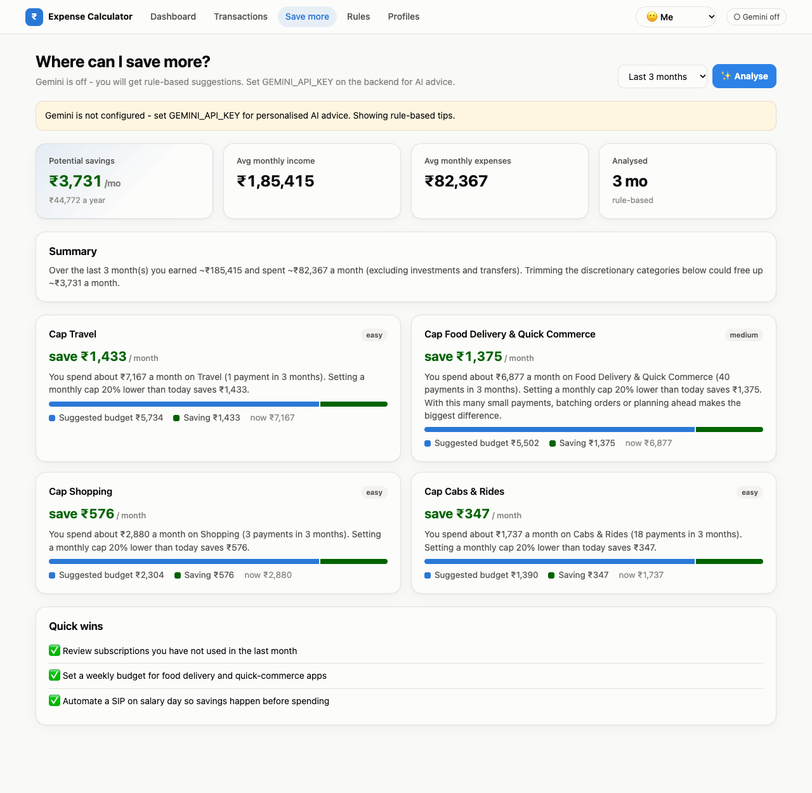

With a Gemini key, the tips are written by Gemini from your category totals, top merchants and recurring payments. They name the actual merchants and amounts, and the result shows "Analysed … by gemini-2.5-flash". Results are cached, so click **Regenerate** for fresh advice. *The screenshot above shows the rule-based fallback you get without a key.*

### Dark mode & phone

The UI follows your system theme and adapts to small screens.

| Dark | Phone |
|---|---|
| 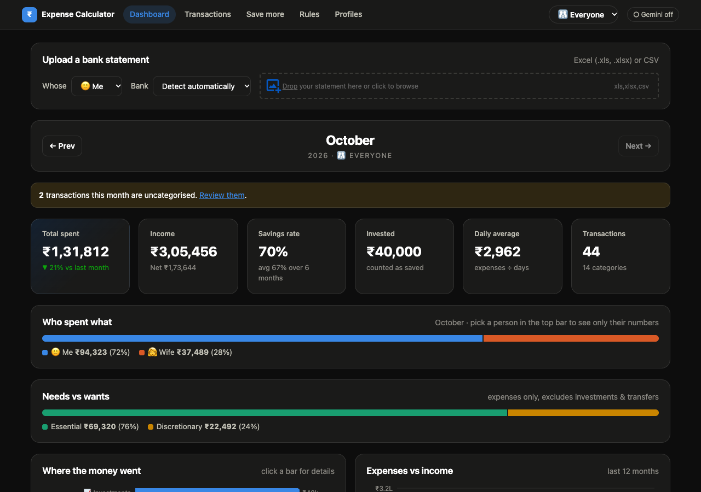 | 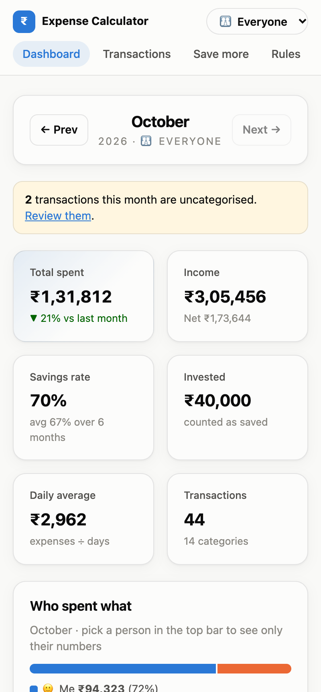 |

---

## Supported banks

| Bank | Formats | Auto-detect | UPI notes |
|---|---|---|---|
| HDFC Bank | xls, xlsx, csv | ✅ | ✅ verified |
| ICICI Bank | xls, xlsx, csv | ✅ | ⚠️ unverified pattern |
| State Bank of India | xls, xlsx, csv | ✅ | ⚠️ unverified pattern |
| Axis Bank | xls, xlsx, csv | ✅ | ⚠️ unverified pattern |
| Kotak Mahindra Bank | xls, xlsx, csv | ✅ | ⚠️ unverified pattern |

HDFC is tested against real statements. The other banks use their published column names, which haven't been checked against real exports yet.

**A bank's file doesn't upload, or you want to add another bank?** Bank layouts are configuration, not code. Open [`src/main/resources/banks.yml`](src/main/resources/banks.yml), copy a block, and set the column headings exactly as they appear in your file:

```yaml
- code: YESBANK
  display-name: Yes Bank
  detect-keywords: [ "YES BANK", "YESB0" ]
  date-formats: [ "dd/MM/yyyy" ]
  headers:
    date: [ "Transaction Date" ]
    narration: [ "Description" ]
    ref: [ "Reference No" ]
    withdrawal: [ "Debit" ]
    deposit: [ "Credit" ]
    balance: [ "Balance" ]
```

Restart the API and the new bank appears in the bank dropdown.

---

## Configuration reference

### Environment variables (API)

| Variable | Default | Purpose |
|---|---|---|
| `GEMINI_API_KEY` | *(empty: AI off)* | Gemini Developer API key |
| `GEMINI_MODEL` | `gemini-2.5-flash` | Gemini model to use |
| `EXPENSE_AI_ENABLED` | `true` | Set to `false` to keep AI off even when a key is set |

### `src/main/resources/application.properties`

| Property | Default | Purpose |
|---|---|---|
| `server.port` | `8081` | API port. If you change it, set `VITE_API_BASE_URL` in the UI. |
| `spring.datasource.url` | `jdbc:h2:~/epnx_db` | Where your data lives |
| `expense.ai.batch-size` | `25` | Transactions per Gemini request |
| `expense.ai.learn-rules` | `true` | Save confident Gemini answers as rules |
| `expense.ai.min-confidence-to-learn` | `0.8` | Minimum confidence before Gemini learns a rule |
| `spring.servlet.multipart.max-file-size` | `10MB` | Largest statement you can upload |

### Other files

| File | Purpose |
|---|---|
| `src/main/resources/banks.yml` | Bank statement layouts, UPI-note patterns, and note words to ignore |
| `src/main/resources/category-seed.yml` | Initial categories and rules, loaded on first start. After that, manage them in the UI. |

### UI

| Variable (`.env.local`) | Default | Purpose |
|---|---|---|
| `VITE_API_BASE_URL` | `http://<page host>:8081/api/expense/v1` | Where the API lives |

---

## Troubleshooting

| Problem | Fix |
|---|---|
| UI shows *"Could not load insights … Is the backend running on port 8081?"* | Start the API (step 1). Check with `curl http://localhost:8081/api/expense/v1/ai/status`. |
| Upload error: *"Could not recognise the bank for this statement"* | Pick the bank in the dropdown instead of *Detect automatically*. |
| Upload error: *"Could not find the transaction table header for …"* | The file's column names differ from `banks.yml`. Add the exact heading to that bank's `headers` and restart. |
| **Gemini off** even though I set the key | The key must be visible to the **API** process. Restart it from a terminal where `echo $GEMINI_API_KEY` prints the key, or set it in IntelliJ's run configuration. |
| Upload says `Gemini: Gemini call failed …` | The upload still succeeded and those rows are left uncategorised. Check the key, your quota, and that `GEMINI_MODEL` exists. Retry later with **Categorise unknown with Gemini**. |
| `Port 8081 was already in use` | Another copy is running. Stop it with `lsof -i :8081` then `kill <pid>`, or change `server.port`. |
| Phone can't open the UI | Make sure `npm run dev` shows a *Network* URL and that the phone is on the same Wi-Fi. The Mac firewall must allow Node and Java incoming connections. |
| `release version 17 not supported` while building | Your JDK is older than 17. Install JDK 17+ and point `JAVA_HOME` at it (`java -version` should show 17 or higher). |
| UPI notes aren't picked up for old transactions | Click **Transactions → Re-apply rules** once. |
| Start completely fresh | Stop the API and delete `~/epnx_db.mv.db`. ⚠️ This erases all data. |
| Look inside the database | Open http://localhost:8081/api/expense/h2-console with JDBC URL `jdbc:h2:~/epnx_db`, user `sa` and an empty password. |

---

## Data & privacy

* All data is stored **locally** in `~/epnx_db.mv.db`. Back it up by copying that file while the API is stopped.
* **Without a Gemini key, nothing leaves your machine.**
* **With a key:**
  * **Categorisation** sends Google only the narrations of transactions that no rule recognised. These include payee names and UPI handles. Transactions matched by a rule are never sent.
  * **Save more** sends only totals: amounts per category, top merchant names and recurring payments. It never sends narrations, account numbers or reference numbers.
* **No login.** Anyone who can open the UI can see every profile. Keep it on your home network, and add authentication before exposing it to the internet.

---

## Development

```bash
# API: 20 tests, use an in-memory DB and never touch ~/epnx_db
./mvnw test

# UI
npm run build
npm run lint     # note: still reports the template's react/prop-types rule, which the codebase doesn't use
```

* How everything is implemented (architecture, the categorisation pipeline, Spring AI/Gemini integration, DB migration, REST API): **[IMPLEMENTATION.md](IMPLEMENTATION.md)**
* REST API base: `http://localhost:8081/api/expense/v1`. Main endpoints are `/profiles`, `/statements/upload`, `/transactions`, `/rules`, `/categories`, `/insights` and `/insights/savings`. The full table is in IMPLEMENTATION.md §11.
* The demo statements were generated by a small script with made-up merchants and amounts. Use them to try the app or to reproduce the screenshots.
